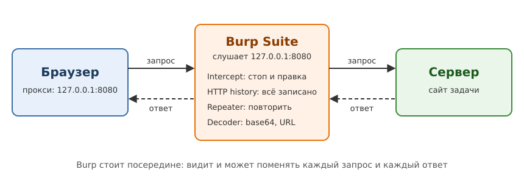
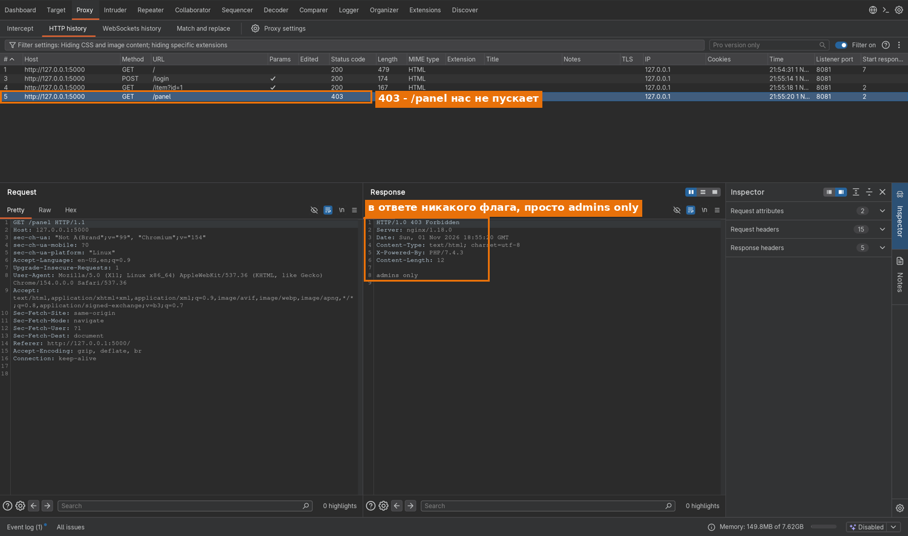
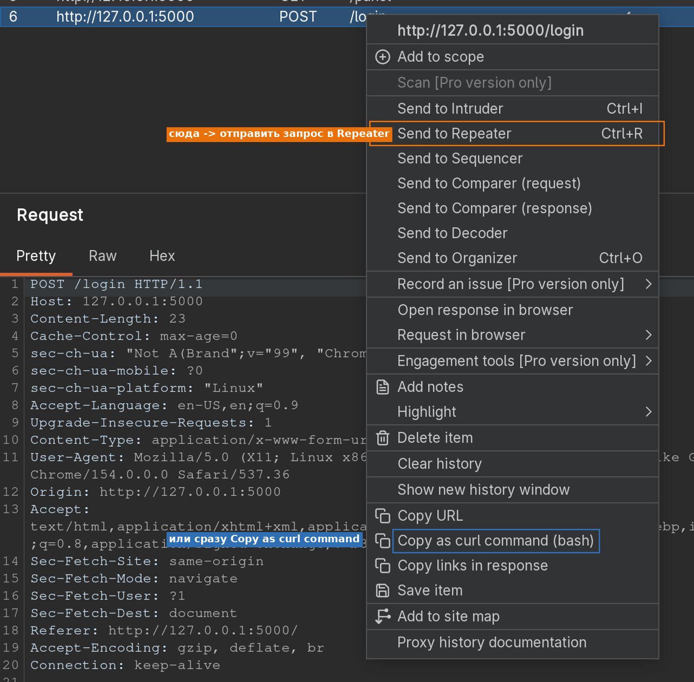
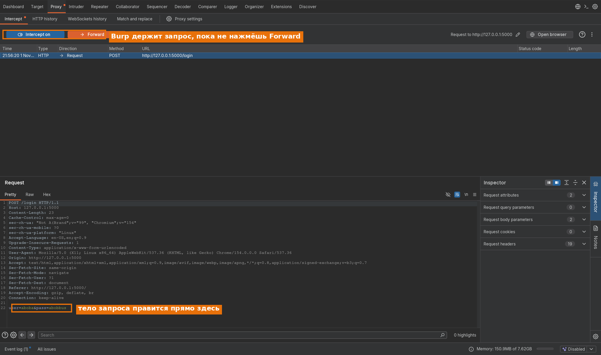
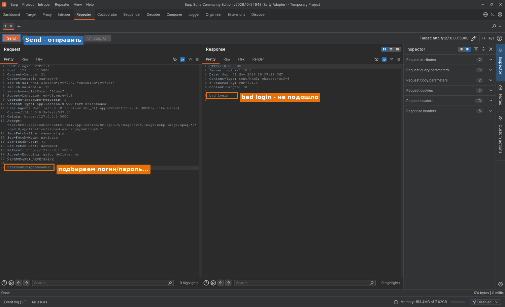
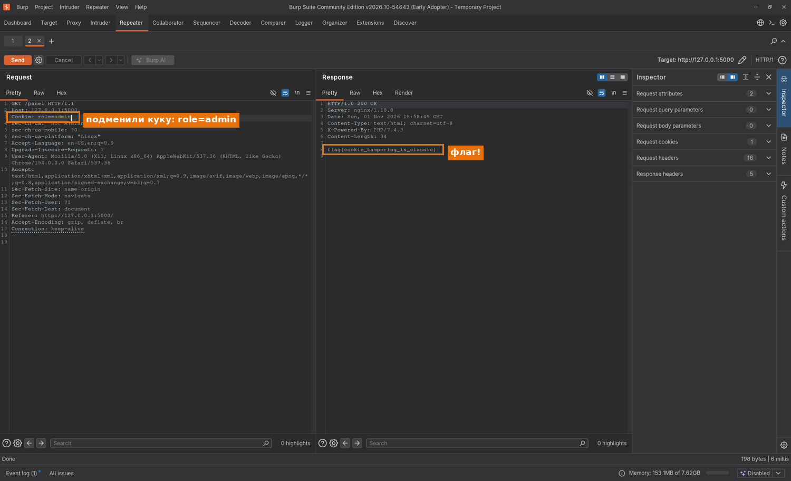

# Burp Suite: перехват и правка HTTP 🔺

Дополнение к главе 6. Читай после `medium.md`: п. 6.3 (`curl`) и 6.6 (куки).

> Burp помогает разобраться в HTTP. На туре его можно заменить на `curl` и Python `requests` (раздел 6).

---

## 1. Зачем он нужен

Флаг может лежать не на странице, а в куке, заголовке, скрытом поле формы или ответе `302`
до редиректа. Burp показывает запросы и ответы до обработки браузером.

**Burp Suite** - это локальный прокси: весь HTTP(S)-трафик браузера идёт сквозь Burp, и любой запрос
можно **остановить, прочитать, изменить и отправить заново**. Хватает бесплатной версии **Community**.



---

## 2. Запускаем за одну кнопку

Проще всего работать во встроенном браузере Burp - он уже настроен на прокси и с сертификатом:

```
Proxy -> Intercept -> Open Browser
```

Трафик этого браузера сразу записывается в Burp. Для своего Firefox настрой прокси
`127.0.0.1:8080` и установи CA-сертификат со страницы `http://burp`.

Для тренировки запусти стенд из этой папки:

```bash
python3 lab/stand.py       # http://127.0.0.1:5000, вход guest / guest, Ctrl+C - остановить
```

---

## 3. Четыре вкладки, которые решают почти всё

| Вкладка | Что делает | Когда брать |
|---|---|---|
| **Proxy** | перехват "на лету" + история всех запросов | осмотреться, поймать нужный запрос |
| **Repeater** | повторить один запрос сколько угодно раз, меняя его | главный рабочий инструмент |
| **Decoder** | URL/Base64/HTML/hex туда и обратно | раскодировать куку или параметр |
| **Comparer** | сравнить два ответа побайтно | понять, чем "правильный" ответ отличается |

**Intruder** перебирает значения, но в Community работает медленно; для перебора удобнее Python.

### 3.1. Proxy -> HTTP history

Здесь записаны **все** запросы через Burp. После просмотра сайта проверь адреса, куки и заголовки.



Любой запрос из истории отправляется в другие инструменты правым кликом. Чаще всего - **Send to
Repeater** (или `Ctrl+R`):



### 3.2. Proxy -> Intercept

Кнопка **Intercept is on** останавливает каждый запрос, пока ты его не отпустишь (*Forward*) или не
выкинешь (*Drop*). Прямо в окне можно поправить любую строку запроса и только потом отпустить.



⚠️ При включённом Intercept страница ждёт, пока ты отпустишь запросы. Если перехват не нужен,
**выключи** его: HTTP history продолжит записывать трафик.

### 3.3. Repeater - твой основной инструмент

Сюда отправляешь один запрос и дальше жмёшь **Send** сколько нужно, меняя что угодно: метод, путь,
заголовки, куки, тело. Ответ - справа. Никакого браузера и перезагрузки страницы.

---

## 4. Разбор на стенде: подмена куки

На стенде после входа ставится кука `role=user`, а флаг на `/panel` отдаётся только при `role=admin`.
Классика: права хранятся у клиента, значит клиент может их поменять.

**1. Осмотрелись.** Во встроенном браузере открыли `http://127.0.0.1:5000`, вошли как `guest`/`guest`.
В HTTP history появился `POST /login` (ответ `302`, `Set-Cookie: role=user`), а `GET /panel` отдаёт
`403 admins only` - флага там нет (скрин в п. 3.1).

**2. Попробовали "в лоб".** Отправили `POST /login` в Repeater и подставили очевидное
`user=admin&pass=admin`. Сервер отвечает `bad login` - логин с наскока не подбирается:



**3. Нашли настоящую слабость.** Роль лежит в куке. Берём `GET /panel`, в Repeater дописываем строку
`Cookie: role=admin` и жмём Send - в ответе флаг:



Тот же результат одной строкой в терминале - чтобы видеть связь:

```bash
curl -s -b 'role=admin' http://127.0.0.1:5000/panel     # -> flag{cookie_tampering_is_classic}
```

🎯 **Тренировка (Burp).** Запусти стенд и пройди все три шага сам. Потом найди в HTTP history ответ на
`GET /` и прочитай в нём HTML-комментарий - он подсказывает про забытый файл. Открой этот файл через
`robots.txt`.

---

## 5. Приёмы, которые экономят время

- **Target -> Scope.** Добавь адрес задачи в scope, а в фильтре HTTP history включи *Show only
  in-scope items* - история перестанет засоряться телеметрией и обновлениями браузера.
- **Поиск по истории.** В фильтре HTTP history есть поле поиска: ищи `flag`, `secret`, `admin` сразу
  по всем запросам и ответам.
- **Match and replace** (*Proxy -> Proxy settings -> Match and replace rules*) - автозамена на лету,
  например всегда подставлять `Cookie: role=admin` или менять `User-Agent`.
- **Decoder.** Куку вида `eyJ...` закинь в Decoder -> *Decode as Base64*: часто внутри JSON с правами.
  Если это JWT (три части через точку) - смотри п. 6.6 (`alg:none`) и `hard.md` (слабый секрет).
- **Inspector** (панель справа в Repeater) раскладывает куки, параметры и заголовки по полочкам.

---

## 6. Burp без Burp: замена на тур

Для простых запросов хватит терминала:

```bash
curl -s -i $U/panel                                   # -i = заголовки ответа (там бывает флаг/302)
curl -s -i -d 'user=guest&pass=guest' $U/login        # отправить форму, увидеть Set-Cookie
curl -s -b 'role=admin' $U/panel                      # подставить свою куку -> флаг
curl -s -L -d 'user=guest&pass=guest' $U/login        # -L = пойти за редиректом 302
```

| В Burp | В терминале |
|---|---|
| HTTP history | `curl -i`, читать заголовки |
| Repeater (повторить и поправить) | `curl` с новыми `-H`/`-b`/`-d`; цикл в Python |
| Intercept + правка | поменять аргументы `curl`/`requests` до отправки |
| Decoder (Base64) | `base64 -d` |
| Intruder (перебор) | цикл `for` в bash или Python |

💡 В меню правого клика (п. 3.1) есть *Copy as curl command (bash)* - Burp сам соберёт готовую команду
`curl` с твоими куками и заголовками, останется вставить её в терминал.

---

## 7. Чек-лист веб-задачи

1. Открыть сайт, **посмотреть исходник** (Ctrl+U) и `robots.txt` - часто там наводка или скрытый путь.
2. Включить Burp (или просто `curl -i`) и глянуть **заголовки и куки** в ответах.
3. Есть форма - отправить, поймать запрос, **поиграть с полями** в Repeater.
4. Есть кука или параметр с правами (`role`, `isAdmin`, `id`) - попробовать поменять.
5. Длинная непонятная строка в куке или URL - прогнать через **Decoder** (Base64/URL/hex).
6. Ничего - искать по истории `flag` и перебирать пути (`web-tools.md`).

---
*Дополнение к главе 6. Рядом: [medium](medium.md) | [hard](hard.md) | [инструменты разведки](web-tools.md) | [оглавление](../00-about.md)*
