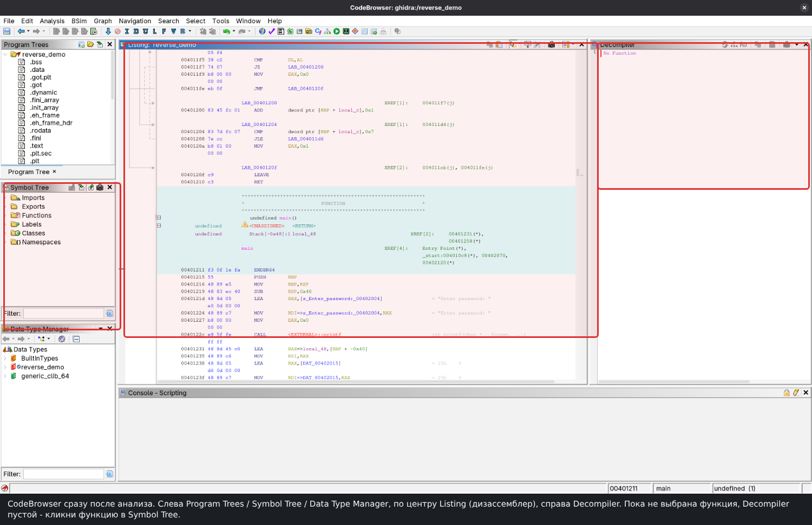
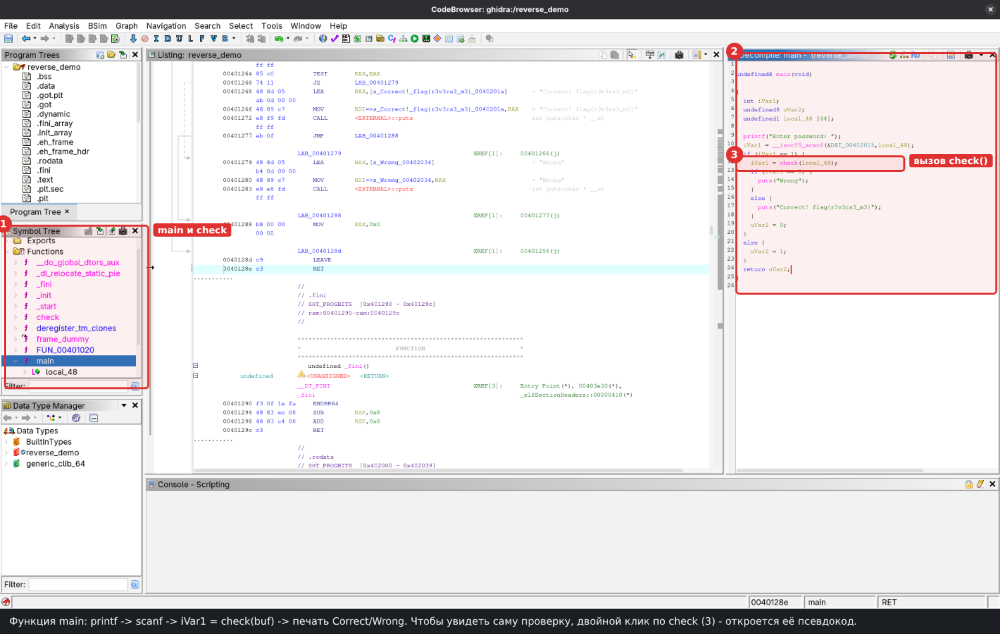
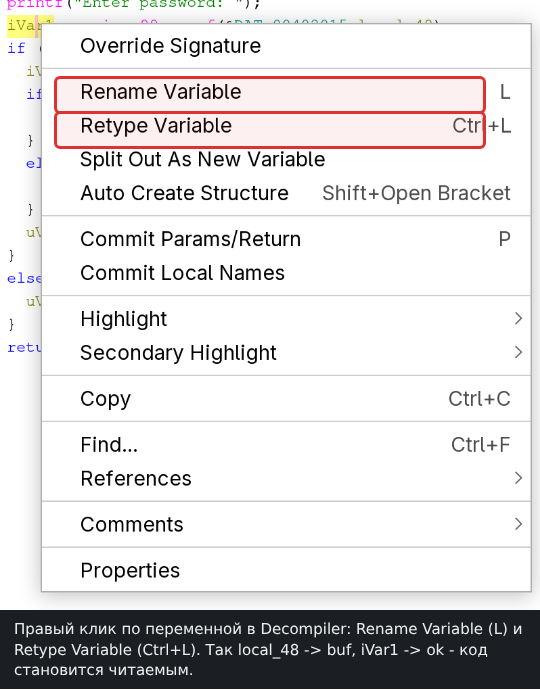
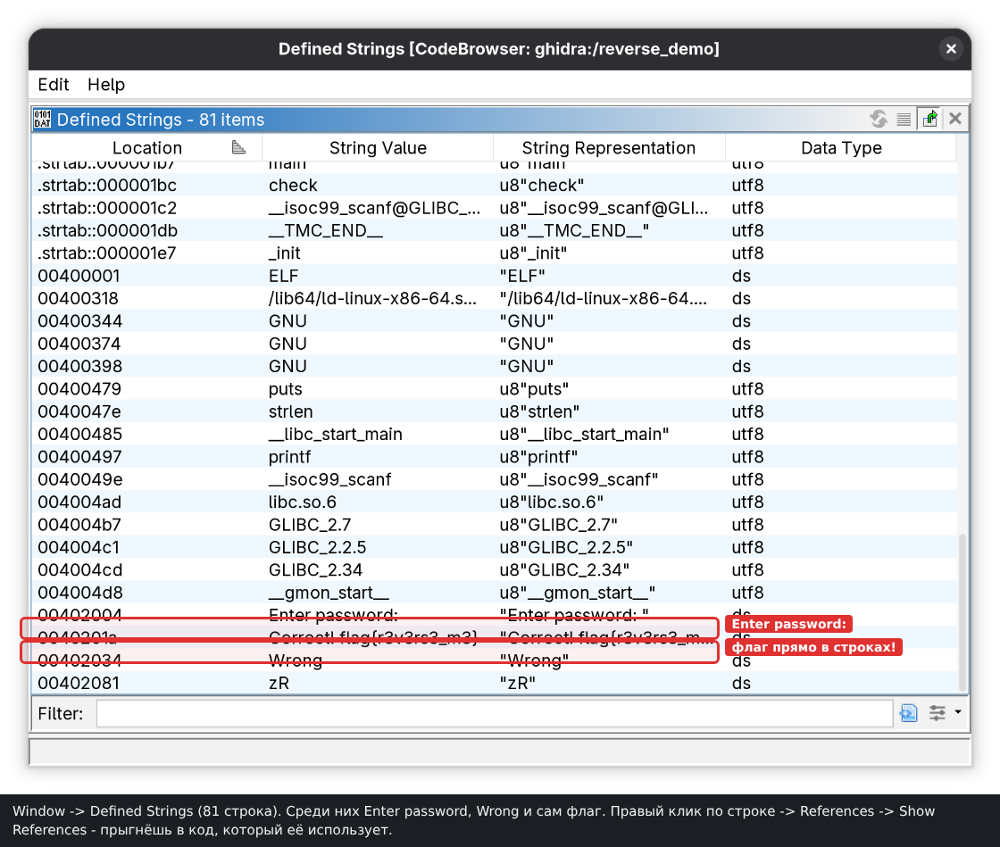

# Ghidra: полный гайд по использованию

Ghidra - бесплатный декомпилятор от АНБ: переводит машинный код в C-подобный псевдокод.
Он пригодится, когда `strings` и `ltrace` не хватает.

Повторяй шаги на учебном **`reverse_demo`** из `08-reverse/img/`. Пароль - `secret99`,
флаг - `flag{r3v3rs3_m3}`. Возьми готовый бинарник или собери в этой папке:
`gcc -no-pie -fno-stack-protector -o reverse_demo reverse_demo.c`.

---

## 1. Создать проект

Проект - контейнер для бинарей.

1. *File -> New Project* -> **Non-Shared Project** -> Next.
2. Выбери папку, впиши имя -> Finish.

## 2. Импортировать файл

1. *File -> Import File* (`I`) -> выбери `reverse_demo` -> OK.
2. Ghidra сама определит формат (`ELF`) и процессор (`x86:LE:64`). Обычно ничего менять не надо.
3. В *Import Results Summary* нажми OK.

## 3. Запустить анализ

1. Двойной клик по файлу -> откроется **CodeBrowser**.
2. На вопрос об анализе ответь **Yes**, в *Analysis Options* оставь настройки по умолчанию
   -> **Analyze**. Маленький бинарь анализируется пару секунд.

> Пропустил вопрос? *Analysis -> Auto Analyze*.

## 4. Из чего состоит окно CodeBrowser



- **Symbol Tree** - функции, метки, импорты/экспорты.
- **Listing** - адреса и ассемблерные инструкции.
- **Decompiler** - псевдокод C, главное окно для чтения логики.
- **Data Type Manager** - типы и структуры.

Пока функция не выбрана, Decompiler пуст. Закрытое окно возвращается через меню **Window**.

## 5. Дойти до нужной функции

В **Symbol Tree -> Functions** найди `main` (или `check`) и дважды кликни: справа появится
псевдокод, а Listing перейдёт к функции.



`main` читает пароль через `scanf`, вызывает `check(buf)` и печатает `Correct!`/`Wrong`.
Проверка - в `check`: дважды кликни по имени в псевдокоде или Symbol Tree.

Если бинарь **stripped** и `main` нет, заходи через строки (п. 8).

## 6. Читать псевдокод

Читай как обычный C: `if`, `==`, циклы, `strcmp`/`memcmp`. В `check` есть массив-эталон `target[]`
и цикл с преобразованием `^ 0x2A`.

![Псевдокод проверки: эталон target[], операция ^ 0x2A, сравнение (схема)](img/ghidra-decompile.png)

Условие победы - `if (... == 0)` или отсутствие `return WRONG`. Цель - понять, что с чем сравнивают.
Подробный разбор - в `medium.md`, п. 8.5.

## 7. Сделать код читаемым: имена и типы

Мусорные имена (`local_48`, `iVar1`, `DAT_...`) мешают читать. Правый клик по переменной:



- **Rename Variable** (`L`): `local_48` -> `buf`, `iVar1` -> `ok`.
- **Retype Variable** (`Ctrl+L`): например, `undefined1[64]` -> `char[64]`.
- Функция переименовывается так же (`L` или *Rename* в Symbol Tree).
- Комментарий: `;` в Listing или правый клик -> *Comments*.

## 8. Строки и ссылки (XREF) - путь на stripped-бинаре

1. *Window -> Defined Strings*.



2. Найди `"Enter password: "` или `"Correct! flag{...}"`.
3. Правый клик -> *References -> Show References to...* -> двойной клик по **XREF**.
   Так попадаешь в функцию, использующую строку, даже без `main`.

В Listing у меток тоже есть кликабельные `XREF[n]`.

## 9. Число -> символ

Правый клик по числу (`== 0x66`) -> *Convert -> Char*: получится `'f'`.

## 10. Скопировать массив-эталон в Python

`target[]` часто показан как `DAT_...`. В **Listing** выдели байты -> *Copy Special* ->
**Python List** (или *Byte String*: `59 4f 49 ...`), затем обработай:

```python
target = [0x59, 0x4f, 0x49, 0x58, 0x4f, 0x5e, 0x13, 0x13]   # из Ghidra
print(bytes(x ^ 0x2A for x in target))                       # -> b'secret99'
```

## 11. Патчинг: заставить проверку всегда проходить

1. В **Listing** найди условный переход после сравнения (`JNZ`, `JZ`, `JLE`...).
2. *Patch Instruction* -> замени логику (`JNZ` -> `JMP`) или поставь `NOP`, чтобы всегда шла
   ветка "успех".
3. *File -> Export Program* -> **Original File** -> получишь новый ELF. Дай `chmod +x` и запускай.

⚠️ Патч помогает, только если флаг **зашит** в программу и печатается в ветке успеха. Если он
**вычисляется** из ввода, нужен правильный вход (п. 8.5).

## 12. Полезное сверх того

- *File -> Export Program -> C/C++* - выгрузить псевдокод в `.c` для грепа.
- *Search -> For Strings* / *Program Text* - поиск по бинарю.
- Стрелки назад/вперёд - переходы по истории.
- `G` - переход по адресу или имени.

## 13. Горячие клавиши

| Клавиша | Действие |
|---|---|
| `I` | импортировать файл |
| `L` | переименовать (переменную/функцию) |
| `Ctrl+L` | сменить тип переменной |
| `;` | комментарий в конце строки (Listing) |
| `G` | перейти по адресу/имени |

## 14. Весь маршрут на `reverse_demo` (итог)

1. *Import* -> анализ.
2. `main` зовёт `check(buf)`.
3. В `check` - `target[]` и цикл `^ 0x2A`.
4. *Copy Special -> Python List* для `target`.
5. `bytes(x ^ 0x2A for x in target)` -> `b'secret99'`.
6. Введи `secret99` -> флаг. Либо патчишь `JNZ`, если флаг зашит.

---
*[назад: medium](medium.md) | [hard](hard.md) | [оглавление курса](../00-about.md)*
